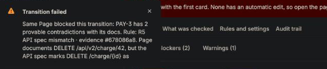
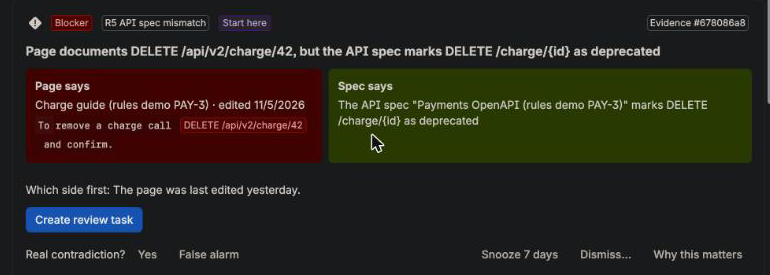
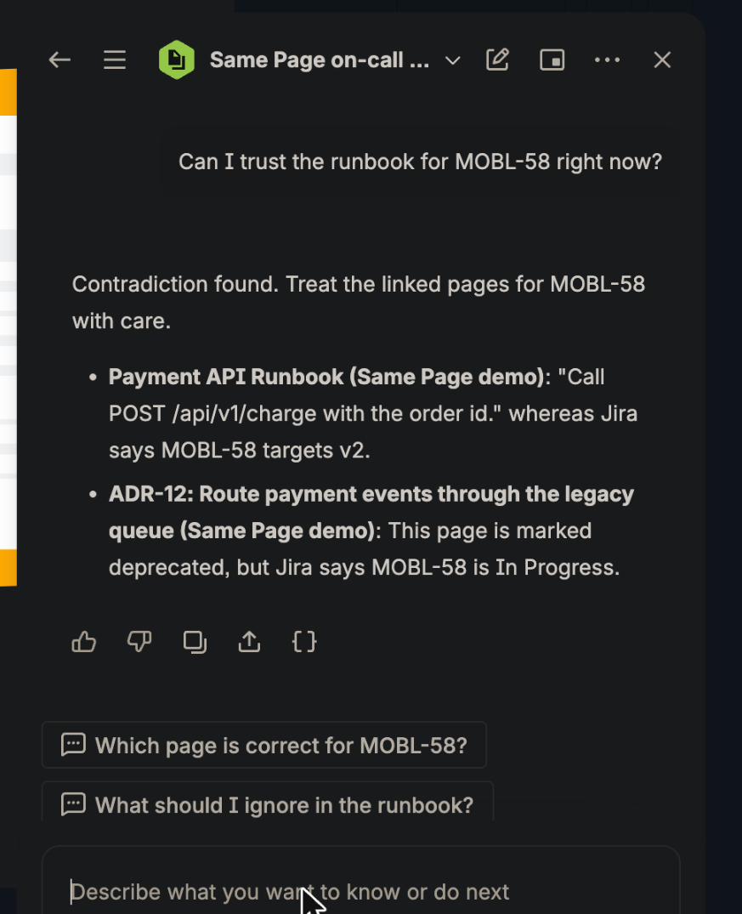

# Same Page

Keep your docs and tickets on the same page.



*Same Page just stopped a move to Done on PAY-3. The message names the rule and carries an evidence id, the same one the panel shows for that finding.*

## What it is

Same Page is a Forge app for Jira and Confluence. It reads the Confluence pages linked to a work item and looks for contradictions it can prove: a runbook that still says `v1` when the epic targets `v2`, a timeout that differs from the ticket, a ticket cited as open that closed last week. Each finding shows the page's own line next to what Jira says.



Think of it as CI for documentation truth. A ticket states facts, pages repeat them, and the check fails when the two disagree, the way a build fails when a test does. Three things make it more than a link checker.

The check can stop a Jira transition. When it refuses a move to Done, the message names the rule and shows the evidence. In an emergency a project admin can let one work item through for 24 hours. That needs a written reason, which goes into the audit log.

People and agents can ask before they act. Confluence is now context for AI agents as well as for people, and a stale runbook turns into a wrong action. The same eight checks are Rovo actions and Atlassian MCP tools, and there is an open skill file at [skills/same-page/SKILL.md](skills/same-page/SKILL.md). `check-issue-docs` also returns a one-line receipt with the work item, the number of pages, the fixed rules and the evidence ids. An agent or a person can paste it next to what they did. It says what ran and never says the docs are correct.

The rules prove and a person approves. We offer a suggested edit only after checking that it changes nothing except the version references on that line, and applying it is refused unless it lands exactly where proposed. New rules start as Draft (counted but hidden), then move to Warning, then Blocker, like a feature flag rollout. A noisy rule can be tried before it blocks anyone.

No model decides what counts as a contradiction. Fixed rules do, so a finding can be repeated and explained afterwards.

## Where it stands

- It runs on real Jira and Confluence sites and in Rovo.
- It catches a stale API version, a deprecated decision, a closed ticket still cited as open, and times, limits and dates that differ. Admins can add their own rules and declare facts that every page on the site should agree on.
- It reads OpenAPI specs written in YAML as well as JSON, and it skips sections headed Legacy, Deprecated, Archive or Previous versions.
- No real team has used it yet, so its accuracy on real documents is unmeasured. Every finding has "real" and "false alarm" buttons so that a pilot can measure it.
- This is our entry for Codegeist 2026 in Apps for Software Teams, and we are going for the Atlassian MCP and Best Agents bonuses. Six Rovo agents and an MCP module are included. The MCP endpoint is live, but we have not recorded a signed-in call from a third-party client yet ([docs/mcp.md](docs/mcp.md)).
- To try it, see [Try it](#try-it).

## The problem

A runbook says `/api/v1/charge`. The Jira epic says the target is `v2`. An on-call engineer follows the runbook and calls a retired endpoint. Anyone could have caught the contradiction weeks earlier, but docs and tickets live in different tools and nobody looked.

## Why detection has no model

We kept AI out of the decision on purpose, for three reasons a team can check.

- The same work item and pages always give the same findings, so a refusal can be reproduced and explained to the person it stopped.
- No model reads page text during detection, so wiki content cannot steer a finding. The agent and MCP tools do hand page text back to a model. Those outputs are flattened, capped and marked as data, which lowers the risk without removing it. That is why the tools are read-only.
- A finding does not change because a model changed.

This is what makes a transition gate defensible. When Same Page stops a transition, the evidence is the page's own line next to Jira's own field. We know of no other app that does this inside a Jira workflow, but we have not surveyed the whole Marketplace.

## Who it is for

Three moments in a software team's week, each with a different person.

A release owner deciding to ship. The gate refuses a move to Done while a blocking contradiction is open, and the release-check agent answers "is project PAY ready to ship?" and says what it could not check.

An on-call engineer about to follow a runbook. The on-call agent answers "can I trust the runbook for PAY-1 right now?" with the page line next to what Jira says.



A developer implementing against an API version. The panel shows a page that still says v1 against a v2 target, the number or date that differs, and what Same Page read from the ticket.

The audit trail helps a fourth reader, a compliance lead, and the spec and duplicate rules help the API team. We lead with the first three.

| Reader | Rules that matter most | What they get |
|---|---|---|
| Release owner, on-call lead | R1 stale version, R4 stale status claim, R6 closed ticket, R8 to R10 numbers and dates | A runbook that contradicts the release is caught before someone follows it. |
| Developer, API and platform team | R1 stale version, R5 spec mismatch, R7 pages disagree | Docs that describe an endpoint the spec does not have, or two pages that give two answers. |
| Governance and compliance lead | R2 deprecated decision, R3 missing field, and the audit log | Withdrawn decisions and missing fields are caught at transition time, and every applied fix is sealed in a tamper-evident log. |

Public surveys put an hour of downtime above $300,000 for over 90% of mid-size and large enterprises (ITIC, 2024). No survey we found isolates outages caused by stale documentation, so we do not claim a saving. The aim is to remove one avoidable cause, and the pilot below is how we plan to measure it.

## How it differs from tools that write docs for you

Code-to-docs generators start from the code and use a model to draft documentation. Same Page starts from the work item and the pages people already wrote, compares them with fixed rules, and stops at the contradiction and its evidence. It writes no prose. That keeps it small and easy to trust, and it can sit beside a docs generator.

It reads Jira work items and Confluence pages only. Reading READMEs, Google Docs or Notion would need external network access, and that would end the app's "no external egress" guarantee, so we left it out. [docs/extending.md](docs/extending.md) sketches how a new source could plug in. It is a design, not a feature.

## What it does

| Step | What happens |
|---|---|
| Discover | Finds candidate pages for a work item through Jira remote links, Confluence search, or a pasted URL. |
| Detect | Runs deterministic rules with no AI, so every finding is reproducible. |
| Show evidence | Shows the exact line from the page beside what Jira says, with timestamps, authors and the stale token highlighted. |
| Propose a fix | Rewrites the line mechanically when that is unambiguous (`v1` to `v2`). For an ambiguous line, an optional Forge-hosted Claude path can reword that one line. It is off by default (see Security), and the result must pass the same rule check before anyone sees it. |
| Human decides | Apply (a Confluence page version that names the approver), create a review task, snooze for 7 days, or dismiss with a required reason. |
| Record | Every Apply is sealed into a hash-chained audit log, and the hash is also anchored on the Jira work item. The same chain holds each finding's handling: first shown, dismissed (with the reason and who), snoozed, turned into a review task, applied. It does not record who merely looked at a finding. |
| Guard | After a fix, the page is pinned. If someone edits the old version back in, Same Page comments on the work item. |
| Gate (optional) | A Jira workflow validator refuses the transition and names the rule, the page, the next step and a short evidence id that matches the one the panel shows. It lets the transition through on any error. The panel and review tasks work without it. |
| Team rules | A Jira administrator can add up to 10 rules from three fixed templates: a phrase on the page while the status is (or is not) a value, a phrase while the work item has a label or component, and a label that needs a phrase. They are plain-text matches, previewed against the current work item before saving. They run in the panel, the gate, the soft gate, the weekly scan and the agents. Rules can be copied as text to another site, and every imported rule is checked like a typed one. |
| Facts everyone should agree on | An administrator declares a fact once ("access token expiry" is "1 hour") and "Check the whole site now" searches Confluence for pages that state it differently. It needs no Jira link, so it reaches pages nobody connected to a work item. It reports and never edits. Matching follows rules R8 to R10: same kind of value, same unit, two shared subject words, with history, dated log lines, examples, defaults and different audiences ("for admin users", "in staging") skipped. |
| Rule stages | Every rule has three stages. Draft runs and is counted but shows nothing and cannot block. Warning shows findings and sends notices. Blocker can also stop a transition. The Rules list shows how many findings a draft rule would have raised, so a new rule can be tried on real data first. |
| Break glass | When a blocker is a false alarm in an emergency, a project administrator or Jira administrator can let one work item through the gate for 24 hours. A written reason is required, the grant and every use are recorded in the audit chain, findings are still shown, and it can be revoked. |
| Rule playground | An administrator pastes sample work item and page text and sees which rules, team rules and declared facts would fire, and on which line. Nothing is read from the site or saved. |
| Watch-only gate | An administrator can set the gate to watch only. It allows every transition and counts the ones it would have refused, shown on the overview. Switch to enforcing when the team trusts it. |
| Pilot report | One button produces a plain-text summary of what Same Page found and what the team marked, with the caveats built in and no page text or names, ready to paste into a message. |
| Notices as it happens | Editing a work item's summary or description into a contradiction leaves one notice comment, and so does moving it to Done with a blocking one open. Notices name rules and a count, never page text, and never block. This works in team-managed projects too. |
| Link a page | Paste the address of a Confluence page on the same site into the panel to link it to the work item. You must be able to read the page. |
| What was read | The "What was checked" tab lists the pages read and the values taken from the work item (for example "2 hours (access token expiry)"), so a person can see what the pages were compared against. |
| Weekly scan | Once a week the app checks open epics, and the project overview shows how many have contradictions and how many are new since the last scan. |
| Overview | A project page called "Same Page overview" lists up to 20 open epics and in-progress work items with a verdict, a finding count and the reason for anything it could not check. It is read-only. |
| Agents | Six read-only Rovo agents share eight checks that are also MCP tools: a general one, a release check (is project PAY ready to ship?), an audit trail agent (what happened to the contradictions on PAY-1?), a rule coach (which rules look noisy here?), a docs owner (which pages are out of step, grouped by page) and an on-call check (can I trust this runbook right now?). They answer from the same evidence as the panel and cannot change anything. See [docs/agent.md](docs/agent.md). |
| Real or false alarm | Every finding has "Yes" and "False alarm" buttons. The marks are counted per rule and shown on the overview and to the agents, with a warning while the sample is under 10. Marking never hides or changes a finding. |
| Impact on this site | The overview shows what Same Page has done here: contradictions found, fixed, sent to owners, dismissed, transitions refused. A time-saved figure appears only if a Jira administrator types their own minutes-per-fix estimate. See [docs/impact.md](docs/impact.md). |

### The rules

| Rule | Default | Fires when |
|---|---|---|
| R1 stale version | Blocker | A linked page documents a version other than the work item's target, and the page was not edited after the status change. |
| R2 deprecated decision | Blocker | A linked decision page is Deprecated or Superseded while the work item is still active. |
| R3 missing field | Warning | A required field is empty while the work item is Done. |
| R4 stale status claim | Warning | A page calls a work item "planned" or "shipped" when Jira says otherwise. |
| R5 spec mismatch | Blocker | A doc line such as `DELETE /api/v2/charge/42` disagrees with an OpenAPI 3 spec (JSON or YAML) held in a linked page. Deprecated is a block, unknown is a warning. |
| R6 closed ticket | Warning | A page treats another ticket as still open ("blocked by PAY-9") but Jira says it is Done or Closed. It only warns. |
| R7 pages disagree | Warning | Two linked pages document the same endpoint or API at different versions (`POST /api/v1/charge` against `/api/v2/charge`, or "Payments API v1" against "v2") and the ticket cannot settle it because it has no target version or targets neither. It shows both lines. It stays silent if the target matches one page (R1 handles that) or the wording is historical. |
| R8 duration differs | Warning | The work item and a page give different times for the same thing, such as "Access token expiry should be 1 hour" against "Access tokens expire after 30 minutes". It reads number words and common phrasings too ("thirty minutes", "half an hour", "1h30m", "two hrs", "120 mins") but not vague amounts like "a couple of hours". |
| R9 limit or port differs | Warning | Different limits, sizes, counts or ports for the same thing ("100 requests per minute" against "200 requests per minute", `port 8080` against `port 9090`). |
| R10 date differs | Warning | Different dates for the same milestone: release, deadline, code freeze or cutover. |

R8 to R10 read the work item's summary and description, so they need no target version and no status change. They stay quiet unless both sides name the same subject and use the same qualifier ("up to", production against staging), the work item gives one value and the page a different one, and the page line is not history. Same Page cannot tell which side is right, so it offers no Apply for these and describes both ways to resolve it.

A Jira administrator can move any rule between Draft, Warning and Blocker from the Rules tab in the panel, which lists all ten rules even when nothing is found. Only a Blocker can stop a transition. Notes that may be intentional history (near "rollback", "legacy", "migration" or "deprecated") are listed but never block.

## Try it

1. Install the app on a site that has Jira and Confluence, using the installation link in the Devpost submission. Install it for both products and accept the consent screens.
2. Open any Jira work item, then the apps menu (the puzzle icon under the title) and choose Same Page. On a site where the panel is already pinned, it sits below the linked pages.
3. As a Jira administrator, click "Create demo data". It creates a runbook page, a deprecated decision page, an epic and the links between them. It is administrator-only because it creates work items and pages.
4. Open the epic it names. You will see three contradictions with evidence: a stale runbook version, a deprecated decision, and a token expiry that the epic and the runbook state differently. Click "Apply" on the runbook version finding, then check the Confluence page history. Version 2 changes only the flagged line.
5. Optional, and it needs a company-managed Jira project and a Jira admin: attach the gate to the Done transition by following [docs/gate-setup.md](docs/gate-setup.md), then try to move the epic to Done before fixing the page.
6. Optional: in Rovo chat, pick "Same Page on-call check" and ask "Can I trust the runbook for `<KEY>` right now?"

Nothing changes unless a person clicks a button. The demo data is created as the person who clicks, in a project and space they can write to.

## What was verified on a real site

All of this was observed on real Jira and Confluence sites: a dev site, and a second site running the production build. [docs/live-results.md](docs/live-results.md) has the full log, including every bug the real site exposed.

- The panel, "Create demo data", the R1, R2, R4 and R5 findings, Apply (page version 2, one line changed), review tasks, snooze and dismiss.
- The gate refusing a move to Done with the evidence (most recently on 7 November 2026, PAY-3, rule R5, evidence #678086a8), and allowing it after Apply fixed the page.
- The gate withholding quoted page text from a person who cannot read the page.
- Break glass end to end: refused, allowed with the override, refused again after it was revoked.
- The audit trail showing "Chain intact", its anchor on the work item, and an exported copy that passed `scripts/verify-export.mjs` while a one-field edit made it fail.
- The pin guard commenting after the old version was edited back.
- The soft gate, the change notices, the weekly scan, R8, team rules, link a page, the severity filter chips and the real or false alarm buttons.
- R9 and R10 firing in the rule playground on the deployed app. They have not yet fired on a real work item.
- The patch preview on a real R1 finding, showing the lines around the change and the one line that changes. In the same test, a `v1` line under a "Legacy" heading was skipped, and an OpenAPI spec written in YAML inside a Confluence code block was read, which made R5 fire on a deprecated operation.
- The optional AI fix on an ambiguous line, which passed the same verification when we switched the AI path on for a test.
- All six agents in Rovo chat. The on-call check and the release check were re-run after we fixed their prompts. The release check on a whole project took about 90 seconds to answer.

## Security and privacy

- The manifest declares no `permissions.external`, so the app calls only Atlassian APIs.
- Panel actions use `asUser`, so reads and writes follow the person's own Confluence permissions. The gate checks page read permission for the person making the transition before it quotes any page text, and shows a redacted message if it cannot tell. If that person cannot read a page, the refusal shows the rule name but not the page title or text.
- Forge storage holds dismiss and snooze records, the audit chain, and counters. The counters hold no page text, titles or names, and the pin guard's comment names no page title or text.
- Detection never calls a model. The shipped app sends nothing to a model unless the developer sets `SAME_PAGE_AI=1`, because Forge LLM calls are billed. When on, it may reword one ambiguous line, capped at 40 calls a day and cached for 24 hours, limited to version-only changes, and its output is rejected unless it passes the rule check.
- Same Page reads Confluence pages and Jira fields through their standard APIs. It does not use the Teamwork Graph.
- Setting the `SAME_PAGE_KILL` environment variable makes the gate allow everything.
- Every scope is listed with its reason in [same-page-app/manifest.yml](same-page-app/manifest.yml).

## Limits

- There is no real-world accuracy figure. Precision and recall of 1.00 are on 30 fixtures the authors wrote, which guards against regressions and measures nothing. We also ran the engine on 559 page and ticket pairs from 12 public Apache projects ([docs/public-data-probe.md](docs/public-data-probe.md)). In the default mode it raised no finding. With the opt-in Fix Version source it raised 4, all false positives, because a product release number is not an API version, so that source stays off. We fixed the two false positives from the first probe (a dated status log and a delivery-phase "v1"), then checked on projects we had not tuned on. That check found more Fix Version false positives, and we guarded two of them. Public wikis rarely state hard facts, so there is still no true finding and no precision figure. The probe shows a low false-alarm rate. It does not show recall, and it is not a pilot. No real team has used the app yet, and [docs/pilot-kit.md](docs/pilot-kit.md) is the plan for collecting honest numbers.
- R8 to R10 are new and tuned to stay quiet. They have not been run on a team's own documents. On a set of 42 reworded cases we wrote ourselves (`fixtures/rewording.json`), they catch 21 of 25 contradictions and leave all 17 agreeing statements alone. Because we wrote those cases, the figure guards our wording and does not measure real recall. The four they miss need real meaning: "the API allows 500 calls a minute" against "rate limit", "signed out after 45 minutes of inactivity" against "session timeout", "retried within 30 seconds" against "retry window", and "a couple of hours". A page that names only "the token" will not match a ticket about "auth token expiry", because we require two shared subject words.
- Verification proves a fix is minimal, not that it is right. An edit must change only version references and clear the flagged contradiction. It does not prove the new version is correct, so a human always reviews it.
- R1 needs a target version on the work item (in the summary, a component, or set from the panel). Without one, R1 is skipped and the panel says so, and the other rules still run. Free-form version names are not matched.
- The Confluence byline finds work items only by Jira keys written in the page text, so a page linked from an epic that never names it shows "not checked".
- The site-wide fact check reads at most 8 pages per fact (the first ones Confluence returns for the subject's nouns) and 5 facts per run. A clean result means those pages agree, not every page. It finds only times, limits and dates, and only a differently worded line that uses the same unit and shares two subject words.
- Team rules are plain-text matches from three templates, with no pattern language. They run everywhere except the Confluence byline. A phrase containing history wording (for example "legacy") is skipped on that line, like the built-in rules.
- R5 reads OpenAPI 3 in JSON or YAML held in a linked Confluence page, in a code block or plain text. It does not read attachments. A spec that does not declare its base path (a `servers` entry) cannot be matched to a documented path that includes it, so R5 stays quiet rather than guess.
- The gate works only in company-managed projects, because Jira does not offer validators in team-managed ones.
- The audit log is tamper-evident. It detects rewritten history, but it cannot stop someone with storage write access from rewriting the whole chain.
- We have not tried third-party MCP clients. The Rovo agent path is verified. `jira:workflowValidator` and `rovo:mcp` are Preview modules, and without the validator the panel and review tasks still work ([docs/gate-setup.md](docs/gate-setup.md)).
- If the optional AI path is off or its daily cap is reached, an ambiguous line gets no automatic edit. The panel says so and offers a review task instead. Detection is unaffected.
- A rule that people mostly dismiss (at least 5 outcomes, half or more dismissed) adds one calm line to the panel. It never hides findings, changes severity, or suppresses a blocker.
- No rule covers environment-name mismatches yet. R6 reads the status of at most 5 tickets a page mentions, by status name only.

## Plan

1. Run a pilot first, with 1 to 3 teams over 1 to 2 weeks. Teams install the app on a test project and label each finding real or false alarm. We report counts and precision with the sample size, whatever they turn out to be. The method is in [docs/pilot-kit.md](docs/pilot-kit.md). No pilot has run yet, so no real-world precision or time-saved figure exists.
2. Still unseen on a real site: rule export and import, and the tuning suggestions. They are covered by offline tests.
3. Choose the next rules from what the pilot's false alarms and misses say. Owners and on-call names are likely candidates.
4. Maybe add an optional AI tier that may only propose candidates, shown only when both quoted lines exist verbatim, warn-only and off by default. It would cost money per call, so it is not built.

## Architecture

```
src/                  detection engine, plain TypeScript, no Forge imports (tested offline)
same-page-app/        the Forge app: manifest, resolvers, UI Kit panel, validator, Rovo tools
  src/core/           synced copy of src/ (npm run sync)
test/  fixtures/      334 tests, the 30-pair fixture set and the reworded-case set
scripts/              live gate check, receipt verifier, payload capture, public-data probe
docs/                 live results, gate setup, pilot kit, feasibility
```

Forge modules: `jira:issuePanel`, `jira:projectPage`, `jira:workflowValidator`, `confluence:contentBylineItem`, two `trigger` modules (a Confluence page-updated guard and a Jira issue-updated watcher), a `scheduledTrigger` for the weekly scan, eight `action` modules, six `rovo:agent` modules, `rovo:mcp` and `llm`. The language is TypeScript (strict) with UI Kit native.

## Run the tests

```bash
npm install
npm test            # 334 tests, all passing (see docs/tests.md)
npm run typecheck
```

Requires Node 24. To verify an Apply receipt offline: `node scripts/verify-receipt.mjs`.

To deploy your own copy, install the Forge CLI (Node 24.22 or later), then from `same-page-app/` run `forge register`, `forge deploy`, and `forge install` for Jira and for Confluence.
